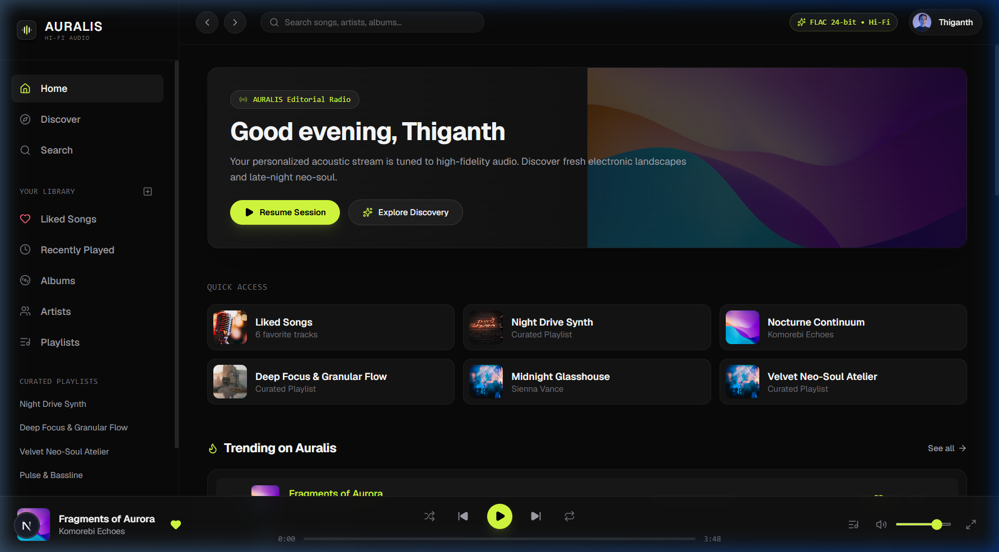
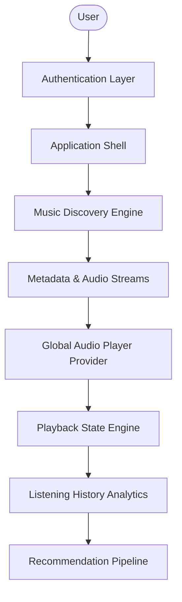

# AURALIS — Music that moves with you

A modern music discovery and streaming platform inspired by high-fidelity audio engineering, curated editorial music spaces, and minimalist interaction design.



---

## 1. Product Overview

**AURALIS** is built from the ground up to provide listeners with an immersive, distraction-free musical environment. Rather than replicating conventional streaming interfaces, AURALIS introduces:

- **Tailored Visual Identity**: Deep dark surfaces (`#090909`, `#111111`, `#181818`) with the signature electric lime (`#D7FF3F`) accent.
- **Persistent Global Audio Engine**: Centralized playback engine with HTMLAudioElement orchestration, queue reordering, and background continuity across navigation.
- **Editorial Discovery Hierarchy**: Time-contextual greetings, quick-launch access grids, trending tracks with live equalizer bars, and genre-defying curated collections.
- **Multi-Device Responsiveness**: Seamless desktop layout with persistent bottom player, alongside an adaptive mobile bottom navigation bar and full-screen tactile player modal.

---

## 2. Technology Stack

- **Framework**: Next.js 16 (App Router, Turbopack)
- **UI & Styling**: React 19, TypeScript, Tailwind CSS v4, Framer Motion
- **Icons & Graphics**: Lucide React & custom AURALIS SVG acoustic glyphs
- **Audio Abstraction**: Browser Native HTMLAudioElement encapsulated in centralized React `PlayerProvider`
- **Database (Phase 2+)**: MongoDB with Mongoose ODM
- **Object Storage**: Cloudflare R2 / S3-compatible audio stream delivery
- **Authentication (Phase 3+)**: NextAuth.js / JWT session-based auth

---

## 3. Architecture & Graphify

Complete architecture diagrams and entity relationships are modeled in [docs/architecture-graphify.md](docs/architecture-graphify.md).



---

## 4. Folder Structure

```text
AURALIS/
├── docs/
│   └── architecture-graphify.md   # Architectural specifications & Graphify models
├── public/                         # Public static assets & brand graphics
├── src/
│   ├── app/
│   │   ├── globals.css             # Tailwind 4 theme tokens & custom scrollbars
│   │   ├── layout.tsx              # Root HTML shell & AppShell wrapper
│   │   └── page.tsx                # Editorial Home Page experience
│   ├── components/
│   │   ├── brand/
│   │   │   └── Logo.tsx            # AURALIS acoustic wave emblem & wordmark
│   │   ├── layout/
│   │   │   ├── AppShell.tsx        # Responsive desktop + tablet + mobile shell
│   │   │   ├── Sidebar.tsx         # Left desktop navigation & library
│   │   │   ├── TopBar.tsx          # Navigation controls, search bar & user profile
│   │   │   └── MobileNav.tsx       # Bottom docked navigation for touch screens
│   │   ├── music/
│   │   │   ├── SongRow.tsx         # Track row with animated equalizer & actions
│   │   │   ├── SongCard.tsx        # Track grid card with hover play overlay
│   │   │   ├── AlbumCard.tsx       # Album card with vinyl sleeve effect
│   │   │   ├── ArtistCard.tsx      # Circular artist portrait card
│   │   │   └── PlaylistCard.tsx    # Curated editorial playlist card
│   │   └── player/
│   │       ├── GlobalPlayer.tsx    # Persistent desktop audio player bar
│   │       ├── MobilePlayer.tsx    # Floating mini player & full player modal
│   │       └── QueueDrawer.tsx     # Slide-out playback queue manager
│   ├── context/
│   │   └── PlayerContext.tsx       # Centralized audio engine, queue & playback state
│   ├── data/
│   │   └── mockData.ts             # Curated sample catalog (artists, albums, songs, playlists)
│   ├── lib/
│   │   └── utils.ts                # Audio time formatting & class name merge utilities
│   └── types/
│       └── index.ts                # TypeScript domain models & player types
├── .env.example                    # Environment variable template
├── package.json
└── tsconfig.json
```

---

## 5. Getting Started

### Prerequisites

- Node.js v20+ or v22+
- npm v10+

### Installation

```bash
# Clone or navigate to the repository
cd AURALIS

# Install dependencies
npm install

# Setup environment variables
cp .env.example .env.local
```

### Running the Development Server

```bash
npm run dev
```

Open [http://localhost:3000](http://localhost:3000) in your browser.

### Verifying Production Build

```bash
npm run build
```

---

## 6. Implementation Roadmap

- [x] **Phase 1: Foundation & Shell** — Branding, dark visual design system, desktop & mobile application shell, persistent global audio player, animated track rows, queue drawer, and editorial home experience.
- [ ] **Phase 2: Database Models** — MongoDB connection, Mongoose schemas (`User`, `Song`, `Artist`, `Album`, `Playlist`, `ListeningHistory`), and seed system.
- [ ] **Phase 3: Authentication** — Secure session & JWT authentication, register/login forms, profile management.
- [ ] **Phase 4: Music Catalog APIs** — Dynamic route handlers for songs, artists, albums, and playlists.
- [ ] **Phase 5: Audio Streaming & Storage** — Cloudflare R2 signed URL streaming and audio buffer management.
- [ ] **Phase 6: Personal Library** — Liked songs, custom playlist creation, track reordering, and recently played persistence.
- [ ] **Phase 7: Search & Discovery** — Debounced multi-entity search, genre filtering, and mood collections.
- [ ] **Phase 8: Polish & Micro-interactions** — Framer Motion page transitions, keyboard shortcuts, and accessibility.
- [ ] **Phase 9: Listening Analytics** — Listening duration tracking, top artists, and weekly audio stats.
- [ ] **Phase 10: Intelligence & Recommendations** — Deterministic recommendation pipeline and personal mixes.
