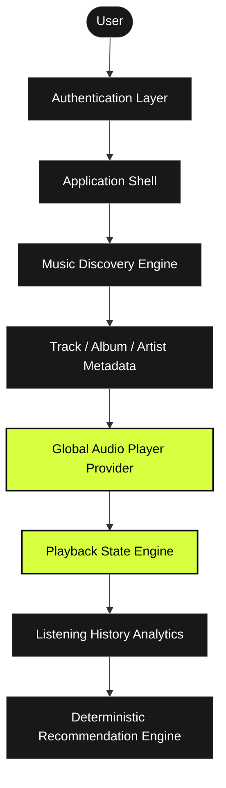
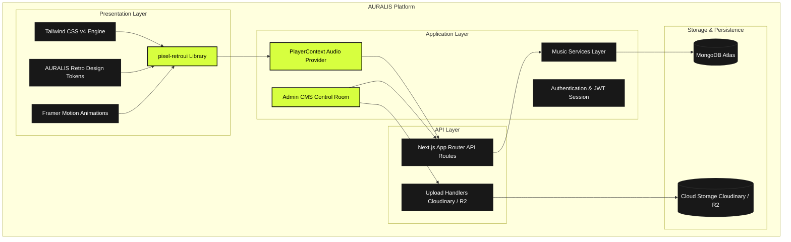
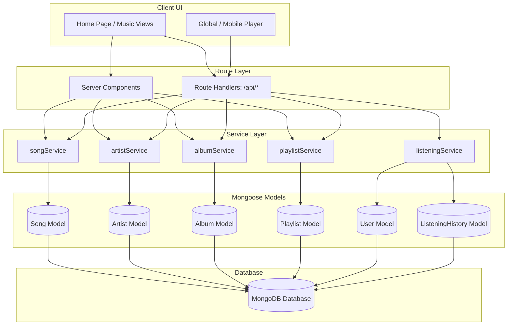
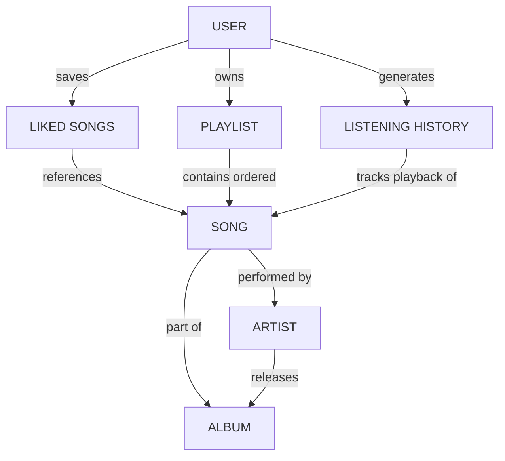
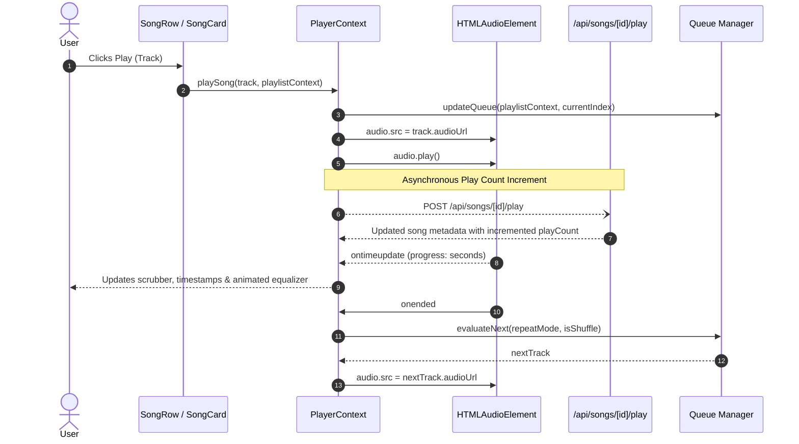
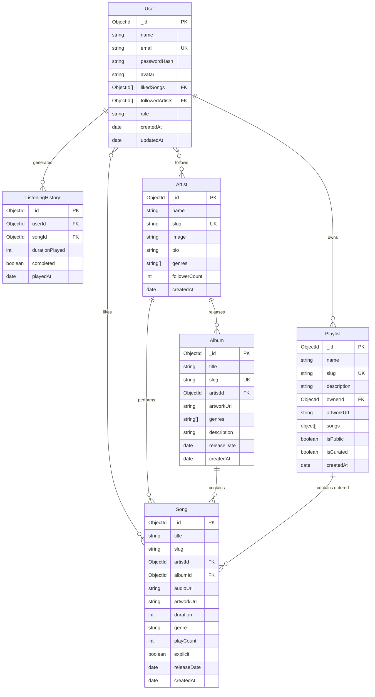
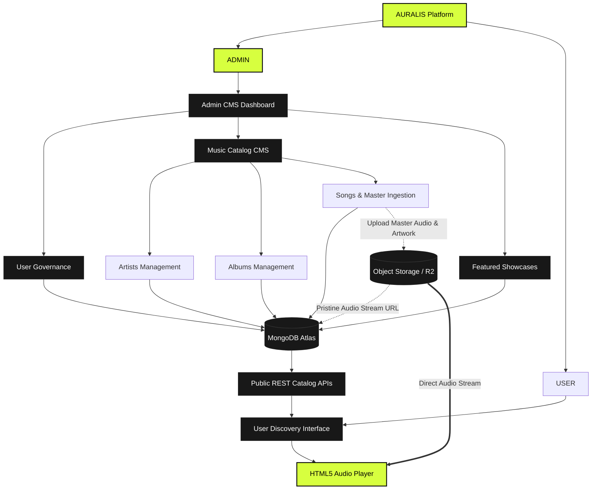
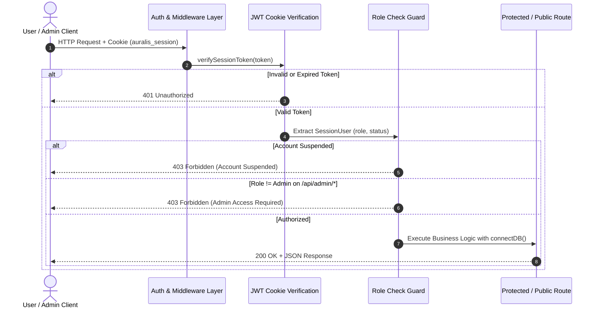

# AURALIS Architecture & Graphify Blueprint

This document details the architectural relationships, component hierarchy, entity models, data access layer, and playback lifecycle for **AURALIS**.

---

## 1. High-Level System Flow



---

## 1.1 Presentation Layer Architecture



---

## 2. Phase 2 Layered Data Architecture



---

## 3. Data Flow & Entity Hierarchy



---

## 4. Playback Architecture & Audio Engine



---

## 5. Entity Relationship Diagram (MongoDB / Mongoose)



```

---

## 6. Phase 3 Dual-Role Music Platform Architecture



---

## 7. Role-Based Authorization Flow



---

## 8. Development Phases Roadmap

```text
Phase 1: Foundation, Design System, AppShell, Global Player Shell, Mock Music Catalog  <-- [COMPLETED]
Phase 2: Database Layer, Mongoose Models, Service Layer, Seed System, APIs              <-- [COMPLETED]
Phase 3: Admin CMS + Authentication + Real Music Management                           <-- [COMPLETED]
Phase 4: Music Catalog Dynamic API routes & Search UI integration
Phase 5: Audio Streaming Engine & Object Storage (Cloudflare R2 Integration)
Phase 6: Personal Library (Liked Songs, Custom Playlists, History)
Phase 7: Search & Discovery Engine (Debounced search, Genre exploration)
Phase 8: Polish, Framer Motion transitions, Accessibility & Micro-interactions
Phase 9: Listening Analytics (Top tracks, genres, duration calculations)
Phase 10: Recommendation Intelligence
```
